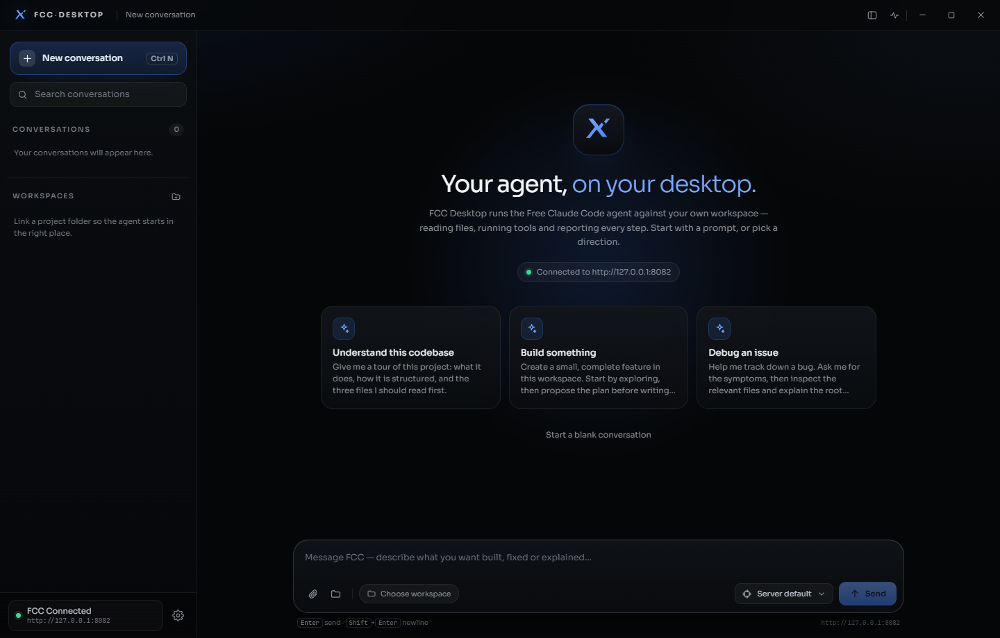

# FCC Desktop

A desktop environment for [Free Claude Code](https://github.com/Alishahryar1/free-claude-code), the Claude Code agent, wired to a local FCC server, with real file access, live model discovery and persistent conversations.

Built as a ground-up rebuild: Electron main process, sandboxed preload bridge, React 19 renderer, zero runtime dependencies shipped to the renderer beyond the bundle.



**[Download the latest build](https://github.com/XiONDiGiTaL/fccGUI/releases/latest)** · [Getting started](#getting-started) · [Build from source](#building-installers)

---

## Contents

- [Screenshots](#screenshots)
- [Features](#features)
- [Requirements](#requirements)
- [Getting started](#getting-started)
  - [1. Install Free Claude Code](#1-install-free-claude-code)
  - [2. Start FCC](#2-start-fcc)
  - [3. Connect a provider](#3-connect-a-provider)
  - [4. Install FCC Desktop](#4-install-fcc-desktop)
  - [5. First conversation](#5-first-conversation)
- [Connecting to FCC](#connecting-to-fcc)
- [Models](#models)
- [Agent permissions](#agent-permissions)
- [Workspaces, files and attachments](#workspaces-files-and-attachments)
- [Data, privacy and security](#data-privacy-and-security)
- [Keyboard shortcuts](#keyboard-shortcuts)
- [Development](#development)
- [Architecture](#architecture)
- [Building installers](#building-installers)
- [Troubleshooting](#troubleshooting)
- [What was verified](#what-was-verified)
- [License](#license)

---

## Screenshots

| Conversation with tool calls | Attachments |
| --- | --- |
|  |  |

| Settings | Packaged build |
| --- | --- |
|  |  |

---

## Features

**FCC server integration**
- Detects a running FCC proxy on `127.0.0.1:8082` (configurable host, port or full base URL override).
- Live connection state in the sidebar with latency, provider and model count, refreshed by a 15 s poll and an immediate probe after any settings change.
- Discovers `fcc-server` and `fcc-claude` from PATH and the standard install locations, with manual executable overrides.
- Start / stop controls that only ever manage a server **this app started**. An externally managed server is reported as such and is never terminated.
- Optional auto-start, which still refuses to spawn a duplicate when anything already answers on the endpoint.

**Real agent, not a chat wrapper**
- Spawns `fcc-claude` with `--print --input-format stream-json --output-format stream-json --include-partial-messages --verbose`, one long-lived process per conversation.
- Multi-turn over stdin: a follow-up message reuses the running agent, and reopening a conversation resumes the stored session with `--resume`.
- Normalised event stream: streaming text, thinking blocks with duration, tool calls with input and output, per-turn usage (duration, output tokens, cost), permission denials.
- Tool activity rendered as expandable cards, with compact status chips (`DONE`, `FAILED`, `RUNNING`).
- Stop mid-turn kills the process tree; the partial answer is kept and marked stopped.
- After 20 minutes idle the agent process is released and resumed from the stored session on the next message.

**Files that actually reach the agent**
- Native file and folder pickers, plus drag and drop onto the composer.
- Image attachments get thumbnails from the main process; text/code/document/archive kinds are classified by extension.
- Attachments are described in the prompt manifest and their directories passed as `--add-dir`, so the agent can read them.
- Workspaces pin a project so every conversation starts in the right place; extra directories are configurable globally.

**Persistence**
- Conversations, messages, tool state, usage and session ids stored as JSON under the app data folder.
- Debounced atomic writes (temp file + rename); no partially written conversation files.
- Settings persisted the same way, restored on launch.
- Proxy token encrypted with the OS keystore via Electron `safeStorage` (DPAPI on Windows) — never written in plain text.

**Interface**
- Frameless XiØN window with custom title bar, sidebar, chat canvas, activity rail and modal settings.
- Design system in one stylesheet: Sora + JetBrains Mono, deep near-black surfaces, blue accent, 18/12 radii, cubic-bezier easing.
- Live model picker with search and grouping, markdown with syntax highlighting, copy actions, toasts.
- Font scale, comfortable/compact density, reduced motion, collapsible sidebar and activity rail.
- Offline state disables sending and explains what to do instead of failing silently.

---

## Requirements

- Windows 10 or 11, x64.
- A working Free Claude Code install — `fcc-server` and `fcc-claude` on `PATH`, or paths set in Settings → Connection → Executables. Don't have it? [Step 1](#1-install-free-claude-code) installs it in one command.
- An FCC server reachable at the configured endpoint. The default install listens on `127.0.0.1:8082`.
- At least one provider key configured in FCC's Admin UI, otherwise the proxy accepts requests but returns provider errors.

Running the packaged app does **not** require Node.js. Building from source does.

---

## Getting started

Five steps from a bare Windows machine to a working agent. Steps 1–3 set up Free Claude Code itself — FCC Desktop is a client for it and cannot run without it. Step 4 installs this app.

### 1. Install Free Claude Code

Open **PowerShell** (Windows Terminal is fine) and paste this, exactly as written:

```powershell
& ([scriptblock]::Create((irm "https://raw.githubusercontent.com/Alishahryar1/free-claude-code/main/scripts/install.ps1")))
```

What it does:

- Downloads FCC with `uv` and installs it per-user under `%USERPROFILE%\.fcc`, creating the `fcc-server` and `fcc-claude` commands.
- Asks which coding agents to set up. Choose **Claude Code** — that is the agent FCC Desktop drives.
- Offers optional token-optimization add-ons (RTK, Headroom). Either answer is fine; they are not required.

Notes:

- Run it in a normal user session. It does not need an elevated shell.
- If PowerShell refuses to run the script with an execution-policy error, allow it for that window only:

  ```powershell
  Set-ExecutionPolicy -Scope Process -ExecutionPolicy Bypass
  ```

  Then run the install command again. To paste it into `cmd.exe` instead:

  ```bat
  powershell -NoProfile -Command "& ([scriptblock]::Create((irm 'https://raw.githubusercontent.com/Alishahryar1/free-claude-code/main/scripts/install.ps1')))"
  ```

- Close and reopen your terminal afterwards so `PATH` picks up the new commands.
- Verify:

  ```powershell
  fcc-server --version
  fcc-claude --version
  ```

  Both should print a version. If either says "not recognized", the install did not finish — rerun the command and check the output.

### 2. Start FCC

The installer adds **Free Claude Code** to the Start menu and the desktop. Launch it there, or run:

```powershell
fcc-server
```

The server listens on `http://127.0.0.1:8082` and opens the **Admin UI** in your browser. Leave it running — FCC Desktop talks to this process. On Windows the tray icon can reopen Admin, restart or quit the server.

FCC Desktop can also start the server for you (Settings → Connection → *Start FCC automatically*), but only when nothing is already listening.

### 3. Connect a provider

FCC is a proxy, not a model. It needs at least one provider key before any agent can answer.

1. Open the Admin UI — the browser tab the server opened, or tray icon → **Admin**. It is normally `http://127.0.0.1:8082/admin`.
2. Create a free key at [build.nvidia.com/settings/api-keys](https://build.nvidia.com/settings/api-keys).
3. In the Admin UI open **Providers → NVIDIA NIM**, click **Add key**, paste the key, then **Save**.
4. Leave `MODEL` on the default, or search the model dropdown for another tool-capable model, then click **Apply**.
5. Optional: enable **Proxy Authentication** to put a bearer token in front of the local proxy. If you do, paste the same token into FCC Desktop under Settings → Connection → *Proxy token* (it is stored encrypted).

NVIDIA NIM is the shortest free path; any of FCC's 61 providers works the same way. Full list and per-provider setup: [FCC → Choose a provider](https://github.com/Alishahryar1/free-claude-code#choose-a-provider).

Confirm the proxy is answering before moving on — this should return JSON containing a model list:

```powershell
curl.exe http://127.0.0.1:8082/v1/models
```

### 4. Install FCC Desktop

Download from the [releases page](https://github.com/XiONDiGiTaL/fccGUI/releases/latest):

| Artifact | Use |
| --- | --- |
| `FCC-Desktop-Setup-1.0.0.exe` | Per-user installer (NSIS). Choose the install directory, plus desktop and Start Menu shortcuts. |
| `FCC-Desktop-Portable-1.0.0.exe` | Single portable executable, no install — run it from anywhere. |

Both are unsigned, so Windows SmartScreen shows *Windows protected your PC* on first launch. Click **More info → Run anyway**. The build is reproducible from source with `npm run dist` (see [Building installers](#building-installers)).

### 5. First conversation

1. Launch FCC Desktop. The sidebar should read **FCC Connected**, with endpoint, provider and latency.
2. If it reads **FCC Offline**, the server from step 2 is not answering. Start it, then press **Reload** in Settings → Connection.
3. Click **Choose workspace** and pick the folder the agent should work in. Without a workspace it runs in the app's data folder, which is rarely what you want.
4. Pick a model from the composer picker. The catalog is read live from `/v1/models`; if it is empty, press **Refresh** there.
5. Type a prompt and press <kbd>Enter</kbd>. Tool calls appear as cards you can expand. <kbd>Esc</kbd> stops a turn.

Nothing is sent while the endpoint is unreachable: the composer goes offline and the Connection panel says what to fix instead of failing silently.

---

## Connecting to FCC

| Setting | Meaning |
| --- | --- |
| Host / Port | Used to build `http://host:port`. Defaults to `127.0.0.1:8082`. |
| Base URL override | Wins over host and port. Use it for a tunnel, a remote box or a non-standard scheme. |
| Start FCC automatically | Starts the discovered `fcc-server` at launch **only** when the endpoint is silent. |
| Proxy token | Optional. Stored encrypted; sent as the Anthropic auth token and as a bearer token for model discovery. |

The app talks to the FCC proxy's Anthropic surface (`/v1/messages`) and its OpenAI surface (`/v1`, `/v1/models`). Everything network-related runs in the main process — the renderer has no network access in production builds.

Agent processes receive `PORT`, `HOST`, `ANTHROPIC_BASE_URL` and `ANTHROPIC_AUTH_TOKEN` explicitly, so an inherited `PORT=0` in your shell cannot break the shim.

---

## Models

The catalog is read live from `/v1/models` and searchable in the composer picker. The list in this build came from an `nvidia_nim` provider with 44 entries, including `claude-fable-5-2`, `claude-opus-5-5` and namespaced variants.

- A conversation stores the model it was created with; changing the picker mid-conversation updates it for subsequent turns.
- New conversations default to `claude-sonnet-5-5` when the catalog offers it, otherwise the first non-"no thinking" entry, otherwise the first model.
- If no model is chosen, the app defers to the server default.
- **Refresh** re-reads the catalog from FCC; a failed refresh keeps the previous list and reports the error.

---

## Agent permissions

The stream-json surface is non-interactive, so permission modes are implemented as explicit `--allowedTools` allowlists rather than prompts you cannot answer.

| Mode | Allowed tools |
| --- | --- |
| `bypassPermissions` (default) | Everything the agent asks for. |
| `acceptEdits` | Read, Glob, Grep, LS, NotebookRead, TodoWrite, Edit, Write, MultiEdit, NotebookEdit. |
| `default` | Read, Glob, Grep, LS, NotebookRead, TodoWrite. |
| `plan` | Read, Glob, Grep, LS, NotebookRead. |

Set the mode in Settings → Agent. Use a restrictive mode when you want the agent to inspect a project without touching it.

---

## Workspaces, files and attachments

- **Workspace** — the agent's working directory (`cwd`) for a conversation. Shown in the chat header and composer; click it to reveal the folder.
- **Additional directories** — extra paths passed with `--add-dir` for every conversation (Settings → Agent).
- **Attachments** — paperclip or folder button, or drop files onto the composer. Images show thumbnails. Each attachment is described in the prompt and its directory is added to the agent's accessible roots. Remove a chip before sending to drop it.

---

## Data, privacy and security

Everything is local. There is no telemetry, no analytics and no remote storage.

| Path | Contents |
| --- | --- |
| `%APPDATA%\FCC Desktop\data\settings.json` | Preferences (no secrets). |
| `%APPDATA%\FCC Desktop\data\secrets.json` | Encrypted proxy token (DPAPI via `safeStorage`). |
| `%APPDATA%\FCC Desktop\data\conversations\<uuid>.json` | Conversations, messages, tool state, usage. |
| `%APPDATA%\FCC Desktop\logs\` | Rolling application log. |

Security posture:

- `contextIsolation: true`, `nodeIntegration: false`, `sandbox: true`, `webviewTag: false`.
- Preload exposes a narrow, typed bridge; every IPC handler validates its arguments (types, lengths, absolute paths).
- Production renderer runs under a CSP with `connect-src 'none'`; navigation to anything but the app URL is blocked, external links open in the browser.
- No `eval`, no remote code, no shell strings built from user input. Agent processes are spawned with an argument array and killed by PID tree.
- Provider credentials live only in main-process memory and the encrypted secrets file.

Clear conversations or export them from Settings → Data. Deleting the app data folder resets the app completely.

---

## Keyboard shortcuts

| Shortcut | Action |
| --- | --- |
| <kbd>Ctrl</kbd> + <kbd>N</kbd> | New conversation |
| <kbd>Ctrl</kbd> + <kbd>,</kbd> | Settings |
| <kbd>Ctrl</kbd> + <kbd>Shift</kbd> + <kbd>E</kbd> | Toggle activity rail |
| <kbd>Enter</kbd> | Send |
| <kbd>Shift</kbd> + <kbd>Enter</kbd> | New line |
| <kbd>Esc</kbd> | Stop the running turn |

---

## Development

```bash
npm install
npm run dev        # Vite dev server + Electron with hot reload
npm run typecheck  # tsc --noEmit
npm run build      # renderer → dist/renderer, main/preload → dist/main
npm start          # run the built app
```

Project layout:

```
electron/
  main.ts              window, CSP, navigation guards, single instance, lifecycle
  preload.ts           typed contextBridge surface
  ipc.ts               validated IPC handlers
  core/                paths, atomic writes, logger, settings, secrets, conversations
  fcc/                 http client, tool discovery, model catalog, connection, agent
src/
  shared/types.ts      contracts shared by main and renderer
  renderer/            App, components, styles, fonts
scripts/
  build-main.mjs       esbuild bundle for main + preload (CJS)
  dev.mjs              dev orchestration
```

Notes:

- React 19 + Vite 6, no UI framework; all styling is one design-system stylesheet.
- Main and preload are bundled with esbuild to CJS because Electron 34's main loader expects it.
- The renderer is a plain Vite build (`base: './'`) loaded from `file://` in production.

---

## Architecture

```
┌───────────────────────────── Electron main ─────────────────────────────┐
│  BrowserWindow (sandboxed renderer)                                     │
│      ▲ preload bridge (invoke/on, validated in ipc.ts)                  │
│  ┌───┴─────────────┐   ┌──────────────────┐   ┌──────────────────────┐  │
│  │ settings        │   │ ConnectionManager│   │ AgentManager         │  │
│  │ conversations   │◄──┤ probe / models   │   │ fcc-claude (stdio)   │  │
│  │ secrets (DPAPI) │   │ owned start/stop │   │ stream-json parser   │  │
│  └─────────────────┘   └────────┬─────────┘   └──────────┬───────────┘  │
└─────────────────────────────────┼────────────────────────┼──────────────┘
                                  │ HTTP                   │ child process
                        FCC proxy 127.0.0.1:8082      fcc-claude ↔ Claude Code
```

Conversation state lives in the renderer's cache, is mirrored to main through `conversations:update`, and is the single source of truth for projection of agent events. The renderer generates each turn id, so a streaming event can never attach to the wrong message.

---

## Building installers

```bash
npm run dist       # NSIS installer + portable exe in release/
npm run dist:dir   # unpacked build only (fast smoke test)
```

`electron-builder.yml` targets `nsis` and `portable` for x64, with the XiØN icon from `build/icon.png`. Output:

```
release/FCC-Desktop-Setup-1.0.0.exe
release/FCC-Desktop-Portable-1.0.0.exe
release/win-unpacked/
```

Code signing is not configured; the artifacts are unsigned.

---

## Troubleshooting

| Symptom | Cause / fix |
| --- | --- |
| Sidebar says **FCC Offline** | Nothing answers at the configured endpoint. Start `fcc-server`, or fix host/port in Settings → Connection. Check with `curl http://127.0.0.1:8082/`. |
| `fcc-claude` exits immediately | Usually a shell `PORT` variable. FCC Desktop sets `PORT`/`HOST` for the child, but a manually launched agent in a shell with `PORT=0` will fail. |
| **Executables: not found** | Install FCC so `fcc-server.exe` and `fcc-claude.exe` are on PATH, or set both paths manually in Settings → Connection → Executables. |
| Model list is empty | The proxy is up but `/v1/models` failed — often a token mismatch. Set the proxy token, then press Refresh in the picker. |
| Agent cannot see a file | The path is outside the workspace and was not attached. Attach it, add its folder under Settings → Agent → additional directories, or switch the workspace. |
| Stop leaves a turn marked running | The process was killed externally; reopen the conversation — stale streaming messages are normalised to stopped on load. |
| Blank window in a packaged build | Launch with `--enable-logging` and check `%APPDATA%\FCC Desktop\logs`. A stale `release/` folder is the usual cause; rebuild with `npm run dist`. |
| Duplicate servers | Only servers started by the app are tracked. The app refuses to start a server when the endpoint already answers. |

---

## What was verified

Against a live FCC server on `127.0.0.1:8082` (`nvidia_nim`, 44 models) and Claude Code `2.1.330`:

- Model discovery, connection probe, latency and provider display.
- A real agent turn with tool calls (shell + file read) rendered as tool cards, with usage footer.
- Follow-up turn in the same conversation reusing the running session; app restart restoring conversation, title, workspace and settings from disk.
- Cancel mid-turn: process tree terminated, partial answer retained, composer returns to idle.
- Offline handling: explicit error message, sending disabled, automatic recovery when the endpoint returns.
- Attachments: file metadata and thumbnails from main, chips in composer and message, persisted with the conversation.
- Packaged build (`win-unpacked`) launching from `app.asar`, connecting, resuming the stored session and completing a turn.

Not exercised in this pass:

- The Start/Stop server buttons (an externally managed FCC server was live and must not be disturbed). The code path only tracks app-owned processes.
- Selecting files inside the native Windows picker (the dialog opens with the right title and filters, and the selection pipeline was validated through the IPC layer).
- A full installer/uninstaller cycle on a clean machine.

---

## License

AGPL-3.0. See [LICENSE](LICENSE).

Built by [XiØN](https://xiondigital.net).
