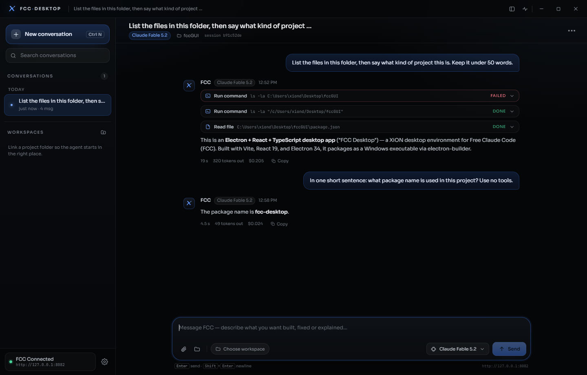
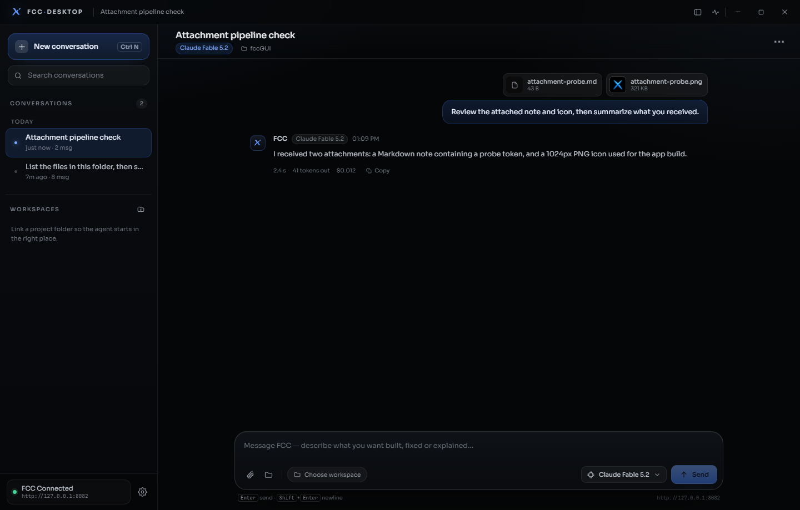
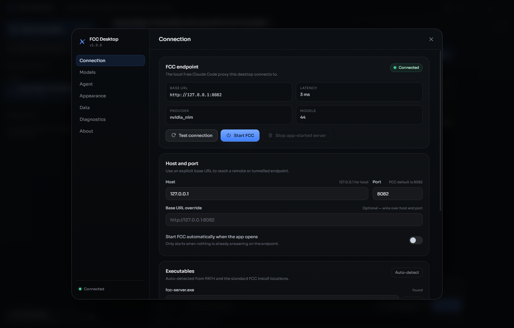
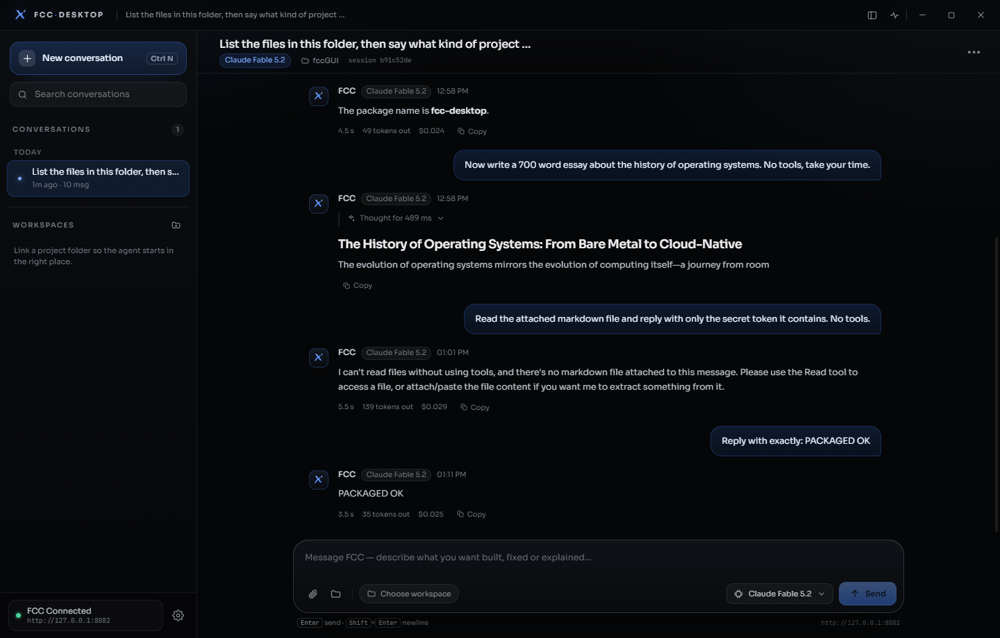

# FCC Desktop

A desktop environment for [Free Claude Code](https://github.com/Alishahryar1/free-claude-code), the Claude Code agent, wired to a local FCC server, with real file access, live model discovery and persistent conversations.

Built as a ground-up rebuild: Electron main process, sandboxed preload bridge, React 19 renderer, zero runtime dependencies shipped to the renderer beyond the bundle.


**[Download the latest build](https://github.com/XiONDiGiTaL/FCCDesktop/releases/latest)** · [Website](https://xiondigital.net/FCCDesktop/) · [Getting started](#getting-started) · [Build from source](#building-installers)

---

## Contents

- [Screenshots](#screenshots)
- [Features](#features)
- [Requirements](#requirements)
- [Getting started](#getting-started)
  - [1. Install Free Claude Code](#1-install-free-claude-code)
  - [2. Start FCC](#2-start-fcc)
  - [3. Connect a provider](#3-connect-a-provider)
  - [4. Install FCC Desktop](#4-install-fcc-desktop)
  - [5. First conversation](#5-first-conversation)
- [Connecting to FCC](#connecting-to-fcc)
- [Models](#models)
- [Agent permissions](#agent-permissions)
- [Workspaces, files and attachments](#workspaces-files-and-attachments)
- [Agent Skills](#agent-skills)
- [Local models](#local-models)
- [Provider usage & rate limits](#provider-usage--rate-limits)
- [Data, privacy and security](#data-privacy-and-security)
- [Keyboard shortcuts](#keyboard-shortcuts)
- [Development](#development)
- [Architecture](#architecture)
- [Building installers](#building-installers)
- [Troubleshooting](#troubleshooting)
- [What was verified](#what-was-verified)
- [License](#license)

---

## Screenshots

| Conversation with tool calls | Attachments |
| --- | --- |
|  |  |

| Settings | Packaged build |
| --- | --- |
|  |  |

---

## Features

**FCC server integration**
- Detects a running FCC proxy on `127.0.0.1:8082` (configurable host, port or full base URL override).
- Live connection state in the sidebar with latency, provider and model count, refreshed by a 15 s poll and an immediate probe after any settings change.
- Discovers `fcc-server` and `fcc-claude` from PATH and the standard install locations, with manual executable overrides.
- Start / stop controls that only ever manage a server **this app started**. An externally managed server is reported as such and is never terminated.
- Optional auto-start, which still refuses to spawn a duplicate when anything already answers on the endpoint.

**Real agent, not a chat wrapper**
- Spawns `fcc-claude` with `--print --input-format stream-json --output-format stream-json --include-partial-messages --verbose`, one long-lived process per conversation.
- Multi-turn over stdin: a follow-up message reuses the running agent, and reopening a conversation resumes the stored session with `--resume`.
- Normalised event stream: streaming text, thinking blocks with duration, tool calls with input and output, per-turn usage (duration, output tokens, cost), permission denials.
- Tool activity rendered as expandable cards, with compact status chips (`DONE`, `FAILED`, `RUNNING`).
- Stop mid-turn kills the process tree; the partial answer is kept and marked stopped.
- After 20 minutes idle the agent process is released and resumed from the stored session on the next message.

**Files that actually reach the agent**
- Native file and folder pickers, plus drag and drop onto the composer.
- Image attachments get thumbnails from the main process; text/code/document/archive kinds are classified by extension.
- Attachments are described in the prompt manifest and their directories passed as `--add-dir`, so the agent can read them.
- Workspaces pin a project so every conversation starts in the right place; extra directories are configurable globally.

**Local models**: download GGUF models from Hugging Face, see which ones fit your GPU, and serve them with llama.cpp so FCC can use them with no provider key.

**Agent Skills**
- A native Skills view: installed library, discovery and configuration in one place, not a folder browser.
- Reads the Claude Code skill folders (`%USERPROFILE%\.claude\skills\`, `<workspace>\.claude\skills\`), so existing skills appear without reinstalling.
- Discover across skills.sh, GitHub repository search and verified curated collections; inspect the real `SKILL.md` before installing.
- Install from a GitHub URL, `owner/repo` or a folder inside a repository; import a local folder or `.zip`; no `npx skills` or Node dependency.
- Enable/disable per skill (moved to a CLI-invisible stash, never deleted), automatic invocation, manual-only mode, categories, update from source, project vs global scope.
- Background update checks compare installed GitHub skills with their source repositories (shortly after launch and every few hours, or when the view opens) and flag the ones that changed upstream, with a single **Update all**. Local edits are never treated as an upstream update.
- Skills reach the model for real: automatic selection composes `/skill-name` invocations, and an inline adapter covers models without native skill support.
- Validation and safety: structure checks, suspicious-instruction findings, no script execution, traversal-safe archives, hash-checked updates. Details in [docs/skills.md](docs/skills.md).

**Persistence**
- Conversations, messages, tool state, usage and session ids stored as JSON under the app data folder.
- Debounced atomic writes (temp file + rename); no partially written conversation files.
- Settings persisted the same way, restored on launch.
- Proxy token encrypted with the OS keystore via Electron `safeStorage` (DPAPI on Windows), never written in plain text.

**Interface**
- Frameless XiØN window with custom title bar, sidebar, chat canvas, activity rail and modal settings.
- Design system in one stylesheet: Sora + JetBrains Mono, deep near-black surfaces, blue accent, 18/12 radii, cubic-bezier easing.
- Live model picker with search and grouping, markdown with syntax highlighting, copy actions, toasts.
- Font scale, comfortable/compact density, reduced motion, collapsible sidebar and activity rail.
- Offline state disables sending and explains what to do instead of failing silently.

---

## Requirements

- Windows 10 or 11, x64.
- A working Free Claude Code install: `fcc-server` and `fcc-claude` on `PATH`, or paths set in Settings → Connection → Executables. Don't have it? [Step 1](#1-install-free-claude-code) installs it in one command.
- An FCC server reachable at the configured endpoint. The default install listens on `127.0.0.1:8082`.
- At least one provider key configured in FCC's Admin UI, otherwise the proxy accepts requests but returns provider errors.

Running the packaged app does **not** require Node.js. Building from source does.

---

## Getting started

Five steps from a bare Windows machine to a working agent. Steps 1–3 set up Free Claude Code itself; FCC Desktop is a client for it and cannot run without it. Step 4 installs this app.

### 1. Install Free Claude Code

Open **PowerShell** (Windows Terminal is fine) and paste this, exactly as written:

```powershell
& ([scriptblock]::Create((irm "https://raw.githubusercontent.com/Alishahryar1/free-claude-code/main/scripts/install.ps1")))
```

What it does:

- Downloads FCC with `uv` and installs it per-user under `%USERPROFILE%\.fcc`, creating the `fcc-server` and `fcc-claude` commands.
- Asks which coding agents to set up. Choose **Claude Code**: that is the agent FCC Desktop drives.
- Offers optional token-optimization add-ons (RTK, Headroom). Either answer is fine; they are not required.

Notes:

- Run it in a normal user session. It does not need an elevated shell.
- If PowerShell refuses to run the script with an execution-policy error, allow it for that window only:

  ```powershell
  Set-ExecutionPolicy -Scope Process -ExecutionPolicy Bypass
  ```

  Then run the install command again. To paste it into `cmd.exe` instead:

  ```bat
  powershell -NoProfile -Command "& ([scriptblock]::Create((irm 'https://raw.githubusercontent.com/Alishahryar1/free-claude-code/main/scripts/install.ps1')))"
  ```

- Close and reopen your terminal afterwards so `PATH` picks up the new commands.
- Verify:

  ```powershell
  fcc-server --version
  fcc-claude --version
  ```

  Both should print a version. If either says "not recognized", the install did not finish; rerun the command and check the output.

### 2. Start FCC

The installer adds **Free Claude Code** to the Start menu and the desktop. Launch it there, or run:

```powershell
fcc-server
```

The server listens on `http://127.0.0.1:8082` and opens the **Admin UI** in your browser. Leave it running; FCC Desktop talks to this process. On Windows the tray icon can reopen Admin, restart or quit the server.

FCC Desktop can also start the server for you (Settings → Connection → *Start FCC automatically*), but only when nothing is already listening.

### 3. Connect a provider

FCC is a proxy, not a model. It needs at least one provider key before any agent can answer.

NVIDIA NIM is the shortest free path: hosted endpoints for prototyping, **no credit card and no per-token billing**, limited by rate rather than credits, roughly 40 requests per minute for most models, with your personal limit shown in the top-right of the build.nvidia.com dashboard. That is plenty for an interactive coding agent.

#### Get a free NVIDIA API key

1. Sign in at [build.nvidia.com](https://build.nvidia.com). A free NVIDIA account is enough: signing in enrols you in the NVIDIA Developer Program, which is what grants the free tier.
2. If prompted, complete account verification. Phone verification is required on many accounts before a key can be generated.
3. Open [build.nvidia.com/settings/api-keys](https://build.nvidia.com/settings/api-keys), or click your profile avatar (top right) → **API Keys**.
4. Click **Generate API Key**, give it a recognisable name such as `fcc-desktop`, and confirm. The value starts with `nvapi-`.
5. Copy the key immediately with **Copy Key**: the full value is shown only once. If you lose it, delete that key and generate a new one.

#### Add the key to FCC

1. Open the **Admin UI**: the browser tab the server opened when it started, or tray icon → **Admin**. It is normally `http://127.0.0.1:8082/admin`, and the exact URL is printed in the server log.
2. Open **Providers**, find **NVIDIA NIM**, click **Add key**.
3. Paste the key into the field and click **Save**.
4. Leave `MODEL` on the default `nvidia_nim/nvidia/nemotron-3-ultra-550b-a55b`, or search the model dropdown and select another model. For a coding agent, pick one that supports tool calling; larger general-purpose models work; tiny or reasoning-only entries tend to fail on tool use.
5. Click **Apply** to save your model selection. FCC keeps the provider active from then on and the model becomes available to every connected client, including FCC Desktop.

#### Or: connect OpenRouter

OpenRouter puts most hosted models behind one key, useful when NVIDIA does not carry the model you want. It is pay-as-you-go, with free variants such as the `openrouter/free` entry point.

1. Create a key at [openrouter.ai/keys](https://openrouter.ai/keys). Copy it immediately; the value is shown only once.
2. In the **Admin UI**, open **Providers**, find **OpenRouter**, click **Add key**, paste the key and click **Save**.
3. Set `MODEL` to `open_router/openrouter/free`, or search the dropdown for a specific `open_router/<vendor>/<model>` entry.
4. Click **Apply**. FCC now serves those models and lists them from `/v1/models`.

FCC prefixes these ids with `open_router/`, so FCC Desktop groups them under **OpenRouter** in the composer picker. Switching providers needs no reinstall: picker contents are read live from FCC, so after adding or changing a model in Admin press **Refresh** in the picker.

#### Optional: protect the local proxy

To put a bearer token in front of the proxy, enable **Proxy Authentication** in Admin and set a token there. FCC then requires it on every request; paste the same token into FCC Desktop under Settings → Connection → *Proxy token*, where it is encrypted with the OS keystore (DPAPI). Leave both blank if only you use this machine.

Any of FCC's 61 providers works the same way; the Admin UI drives all of them. Full list and per-provider setup: [FCC → Choose a provider](https://github.com/Alishahryar1/free-claude-code#choose-a-provider).

Confirm the proxy is answering before moving on. This should return JSON containing a model list:

```powershell
curl.exe http://127.0.0.1:8082/v1/models
```

### 4. Install FCC Desktop

Download from the [releases page](https://github.com/XiONDiGiTaL/FCCDesktop/releases/latest):

| Artifact | Use |
| --- | --- |
| `FCC-Desktop-Setup-1.0.4.exe` | Per-user installer (NSIS). Choose the install directory, plus desktop and Start Menu shortcuts. |
| `FCC-Desktop-Portable-1.0.4.exe` | Single portable executable, no install; run it from anywhere. |

Both are unsigned, so Windows SmartScreen shows *Windows protected your PC* on first launch. Click **More info → Run anyway**. The build is reproducible from source with `npm run dist` (see [Building installers](#building-installers)).

### 5. First conversation

1. Launch FCC Desktop. The sidebar should read **FCC Connected**, with endpoint, provider and latency.
2. If it reads **FCC Offline**, the server from step 2 is not answering. Start it, then press **Reload** in Settings → Connection.
3. Click **Choose workspace** and pick the folder the agent should work in. Without a workspace it runs in the app's data folder, which is rarely what you want.
4. Pick a model from the composer picker. The catalog is read live from `/v1/models`; if it is empty, press **Refresh** there.
5. Type a prompt and press <kbd>Enter</kbd>. Tool calls appear as cards you can expand. <kbd>Esc</kbd> stops a turn.

Nothing is sent while the endpoint is unreachable. The offline state and Settings → Connection show the setup steps in the app itself: the FCC install command with a copy button, how to start the server, and where to add either a free NVIDIA key or an OpenRouter key in the Admin UI. The connection re-checks every 15 seconds, so the composer unlocks on its own once FCC answers.

---

## Connecting to FCC

| Setting | Meaning |
| --- | --- |
| Host / Port | Used to build `http://host:port`. Defaults to `127.0.0.1:8082`. |
| Base URL override | Wins over host and port. Use it for a tunnel, a remote box or a non-standard scheme. |
| Start FCC automatically | Starts the discovered `fcc-server` at launch **only** when the endpoint is silent. |
| Proxy token | Optional. Stored encrypted; sent as the Anthropic auth token and as a bearer token for model discovery. |

The app talks to the FCC proxy's Anthropic surface (`/v1/messages`) and its OpenAI surface (`/v1`, `/v1/models`). Everything network-related runs in the main process; the renderer has no network access in production builds.

Agent processes receive `PORT`, `HOST`, `ANTHROPIC_BASE_URL` and `ANTHROPIC_AUTH_TOKEN` explicitly, so an inherited `PORT=0` in your shell cannot break the shim.

---

## Models

The catalog is read live from `/v1/models` and searchable in the composer picker. The list in this build came from an `nvidia_nim` provider with 44 entries, including `claude-fable-5-2`, `claude-opus-5-5` and namespaced variants.

- A conversation stores the model it was created with; changing the picker mid-conversation updates it for subsequent turns.
- New conversations default to `claude-sonnet-5-5` when the catalog offers it, otherwise the first non-"no thinking" entry, otherwise the first model.
- If no model is chosen, the app defers to the server default.
- **Refresh** re-reads the catalog from FCC; a failed refresh keeps the previous list and reports the error.

---

## Agent permissions

The stream-json surface is non-interactive, so permission modes are implemented as explicit `--allowedTools` allowlists rather than prompts you cannot answer.

| Mode | Allowed tools |
| --- | --- |
| `bypassPermissions` (default) | Everything the agent asks for. |
| `acceptEdits` | Read, Glob, Grep, LS, NotebookRead, TodoWrite, Edit, Write, MultiEdit, NotebookEdit. |
| `default` | Read, Glob, Grep, LS, NotebookRead, TodoWrite. |
| `plan` | Read, Glob, Grep, LS, NotebookRead. |

Set the mode in Settings → Agent. Use a restrictive mode when you want the agent to inspect a project without touching it.

---

## Workspaces, files and attachments

- **Workspace**: the agent's working directory (`cwd`) for a conversation. Shown in the chat header and composer; click it to reveal the folder.
- **Additional directories**: extra paths passed with `--add-dir` for every conversation (Settings → Agent).
- **Attachments**: paperclip or folder button, or drop files onto the composer. Images show thumbnails. Each attachment is described in the prompt and its directory is added to the agent's accessible roots. Remove a chip before sending to drop it.

---

## Agent Skills

Skills are specialised instruction packs (`SKILL.md` + references, scripts and assets) that an agent loads when a task
matches. FCC manages them end to end and feeds them into the same Claude Code process that runs your conversations.

- **Discover**: search skills.sh, GitHub repositories or curated collections; filter by one of 80+ categories; inspect the actual `SKILL.md`, bundled files and safety findings before installing.
- **Install**: paste a GitHub URL or `owner/name`, pick skills from the parsed listing, and choose global or project scope. Private repositories work when `gh auth login` has been used. Local folders and `.zip` archives import too.
- **Manage**: enable/disable per skill, turn automatic invocation off for a skill (manual only), assign a category, update from its source repository, open the folder or repository, remove FCC-installed skills. Disabling moves the folder to `.fcc-disabled/` so Claude Code stops seeing it; it is never deleted.
- **Use**: the active model sees enabled skills through Claude Code's native registry, and FCC selects the relevant ones for each message (or you pick them with the **Skills** button or `/skill-name`). The header chip shows what was applied, whether it was automatic, and why.
- **Switch delivery**: *Native* lets the CLI load `SKILL.md` on demand; *Inline* pastes the selected instructions into the prompt with a budget, for models or CLI builds without native skills.

Full documentation: **[docs/skills.md](docs/skills.md)**: architecture, security model, provider compatibility, writing your own skills and known limitations.

---

## Local models

FCC Desktop can download GGUF models from Hugging Face and run them with llama.cpp, so a conversation can run on your own GPU without a provider key.

- **Hardware profile**: CPU, threads, RAM and GPU VRAM (read from the display driver on Windows, since `AdapterRAM` caps at 4 GB). It decides the fit labels and which llama.cpp build to install.
- **Index**: the Recommended list is built by searching Hugging Face per model family (Qwen Coder, Qwen, gpt-oss, DeepSeek R1, Llama, Gemma, Mistral, GLM, Phi, Devstral), preferring proven GGUF publishers over community re-uploads, then download counts. Sizes come from the repositories themselves. Search any repository by name; the index caches for six hours.
- **Fit**: each quant is scored against this machine: *Runs on GPU* (fits in 94% of VRAM), *Partial offload*, *CPU only* or *Too large*. Quant and file size are selectable per model.
- **Storage**: pick any folder. GGUF files already in it are listed as installed even when they were added by hand.
- **Downloads**: resumable (`.part` + `Range`), cancelable, with speed and progress. Gated repositories are refused with a reason because no Hugging Face token is stored.
- **Runtime**: installs the newest llama.cpp nightly build: Vulkan on Windows/Linux, Metal on macOS, CPU fallback, with ROCm selectable per machine (and a one-click *Reinstall as …* when you change it). No CUDA toolkit needed.
- **Load settings**: context, GPU layers, threads, batch size, flash attention (`-fa on`) and keep-in-memory (`--no-mmap`), applied on the next Run. The vocabulary follows LM Studio's load dialog so the concepts carry over.
- **Using it**: installed GGUF files appear in the chat model picker under **Local models**: picking one starts `llama-server` on `127.0.0.1:8080` for that file and sends the FCC id `llamacpp/<alias>` with the conversation. *Run* in the library does the same by hand and shows the endpoint. When FCC Desktop starts the FCC server itself it passes `LLAMACPP_BASE_URL`; if FCC runs separately, point **Providers → llama.cpp** in its Admin UI at the shown URL.

Details, architecture and limits: [`docs/local-models.md`](docs/local-models.md).

## Provider usage & rate limits

A **Usage & limits** view shows what the active provider reports, what FCC Desktop counted, and what is unavailable,
without inventing a quota.

- **Provider status**: provider name, active model, key configuration state from FCC's own Admin status, last sync and connection state. Interactive through the sidebar entry and the in-chat banner.
- **Rate-limit handling**: a `429` is classified as temporary throttling or exhausted quota, the upstream provider, category and request ID are captured, and a live countdown appears when the error contains a retry/reset time. Without a time, the report is treated as current only while it is recent (90 seconds for throttling, 15 minutes for exhausted quota), then it stays visible as a dated “last reported, no longer current” line instead of a permanent status.
- **Local activity**: request attempts, successes, failures, `429`s, reported tokens, per-model totals, today, 7 days and a 30-day timeline. Every figure is labelled **Locally tracked**, never as remaining account quota.
- **Honest limits**: NVIDIA NIM publishes no usage or remaining-quota API and its 429s usually carry no rate-limit headers, so provider quota is shown as **Not exposed**. Provider capability notes explain the same for OpenRouter, Anthropic/OpenAI, Groq and local providers.
- **Refresh**: when the first connection probe succeeds and after a reconnect, after a turn, after a 429, when a cooldown ends, on a configurable interval (30 s–15 min, default 2 min) or manually. It reads FCC metadata only and never sends a model request, so monitoring cannot itself consume quota.
- **Offline**: the last successful status and local history are cached and marked as cached when FCC is unreachable.

Full technical notes, data sources and provider limitations: [`docs/usage-monitor.md`](docs/usage-monitor.md).

## Data, privacy and security

Everything is local. There is no telemetry, no analytics and no remote storage.

| Path | Contents |
| --- | --- |
| `%APPDATA%\FCC Desktop\data\settings.json` | Preferences (no secrets). |
| `%APPDATA%\FCC Desktop\data\secrets.json` | Encrypted proxy token (DPAPI via `safeStorage`). |
| `%APPDATA%\FCC Desktop\data\conversations\<uuid>.json` | Conversations, messages, tool state, usage. |
| `%APPDATA%\FCC Desktop\data\usage.json` | Local request counts, last 429 metadata and cached provider status. No credentials. |
| `%APPDATA%\FCC Desktop\logs\` | Rolling application log. |

Security posture:

- `contextIsolation: true`, `nodeIntegration: false`, `sandbox: true`, `webviewTag: false`.
- Preload exposes a narrow, typed bridge; every IPC handler validates its arguments (types, lengths, absolute paths).
- Production renderer runs under a CSP with `connect-src 'none'`; navigation to anything but the app URL is blocked, external links open in the browser.
- No `eval`, no remote code, no shell strings built from user input. Agent processes are spawned with an argument array and killed by PID tree.
- Provider credentials live only in main-process memory and the encrypted secrets file.

Clear conversations or export them from Settings → Data. Deleting the app data folder resets the app completely.

---

## Keyboard shortcuts

| Shortcut | Action |
| --- | --- |
| <kbd>Ctrl</kbd> + <kbd>N</kbd> | New conversation |
| <kbd>Ctrl</kbd> + <kbd>,</kbd> | Settings |
| <kbd>Ctrl</kbd> + <kbd>Shift</kbd> + <kbd>E</kbd> | Toggle activity rail |
| <kbd>Enter</kbd> | Send |
| <kbd>Shift</kbd> + <kbd>Enter</kbd> | New line |
| <kbd>Esc</kbd> | Stop the running turn |

---

## Development

```bash
npm install
npm run dev        # Vite dev server + Electron with hot reload
npm run typecheck  # tsc --noEmit
npm run build      # renderer → dist/renderer, main/preload → dist/main
npm start          # run the built app

npm run test:skills
npm run test:local
npm run test:usage
```

Project layout:

```
electron/
  main.ts              window, CSP, navigation guards, single instance, lifecycle
  preload.ts           typed contextBridge surface
  ipc.ts               validated IPC handlers
  core/                paths, atomic writes, logger, settings, secrets, conversations
  fcc/                 http client, tool discovery, model catalog, connection, agent
  usage/               provider usage monitor, 429 classification, local telemetry
src/
  shared/types.ts      contracts shared by main and renderer
  shared/usage.ts      usage contracts, header/error parsers, capability and summaries
  renderer/            App, components, styles, fonts
scripts/
  build-main.mjs       esbuild bundle for main + preload (CJS)
  dev.mjs              dev orchestration
```

Notes:

- React 19 + Vite 6, no UI framework; all styling is one design-system stylesheet.
- Main and preload are bundled with esbuild to CJS because Electron 34's main loader expects it.
- The renderer is a plain Vite build (`base: './'`) loaded from `file://` in production.

---

## Architecture

```
┌───────────────────────────── Electron main ─────────────────────────────┐
│  BrowserWindow (sandboxed renderer)                                     │
│      ▲ preload bridge (invoke/on, validated in ipc.ts)                  │
│  ┌───┴─────────────┐   ┌──────────────────┐   ┌──────────────────────┐  │
│  │ settings        │   │ ConnectionManager│   │ AgentManager         │  │
│  │ conversations   │◄──┤ probe / models   │   │ fcc-claude (stdio)   │  │
│  │ secrets (DPAPI) │   │ owned start/stop │   │ stream-json parser   │  │
│  └─────────────────┘   └────────┬─────────┘   └──────────┬───────────┘  │
└─────────────────────────────────┼────────────────────────┼──────────────┘
                                  │ HTTP                   │ child process
                        FCC proxy 127.0.0.1:8082      fcc-claude ↔ Claude Code
```

Conversation state lives in the renderer's cache, is mirrored to main through `conversations:update`, and is the single source of truth for projection of agent events. The renderer generates each turn id, so a streaming event can never attach to the wrong message.

---

## Building installers

```bash
npm run dist       # NSIS installer + portable exe in release/
npm run dist:dir   # unpacked build only (fast smoke test)
```

`electron-builder.yml` targets `nsis` and `portable` for x64, with the XiØN icon from `build/icon.png`. Output:

```
release/FCC-Desktop-Setup-1.0.4.exe
release/FCC-Desktop-Portable-1.0.4.exe
release/win-unpacked/
```

Code signing is not configured; the artifacts are unsigned.

---

## Troubleshooting

| Symptom | Cause / fix |
| --- | --- |
| Sidebar says **FCC Offline** | Nothing answers at the configured endpoint. Start `fcc-server`, or fix host/port in Settings → Connection. Check with `curl http://127.0.0.1:8082/`. |
| `fcc-claude` exits immediately | Usually a shell `PORT` variable. FCC Desktop sets `PORT`/`HOST` for the child, but a manually launched agent in a shell with `PORT=0` will fail. |
| **Executables: not found** | Install FCC so `fcc-server.exe` and `fcc-claude.exe` are on PATH, or set both paths manually in Settings → Connection → Executables. |
| Model list is empty | The proxy is up but `/v1/models` failed, often a token mismatch. Set the proxy token, then press Refresh in the picker. |
| Provider errors (`401`, `403`, `404` on a model) | The NVIDIA key was not saved or not applied. In Admin → Providers → NVIDIA NIM check the key row, hit **Save**, then **Apply** again. Keys are shown only once when generated, so regenerate if the value was lost. |
| `429` or "rate limit" mid-conversation | The free NVIDIA tier is rate-limited (a baseline of about 40 requests/minute, varying by model and traffic). Open **Usage & limits** to see whether it is temporary throttling or exhausted quota, any reported retry time, and locally counted activity. Wait a minute, or add a second provider key in Admin. |
| Agent cannot see a file | The path is outside the workspace and was not attached. Attach it, add its folder under Settings → Agent → additional directories, or switch the workspace. |
| Stop leaves a turn marked running | The process was killed externally; reopen the conversation. Stale streaming messages are normalised to stopped on load. |
| Blank window in a packaged build | Launch with `--enable-logging` and check `%APPDATA%\FCC Desktop\logs`. A stale `release/` folder is the usual cause; rebuild with `npm run dist`. |
| Duplicate servers | Only servers started by the app are tracked. The app refuses to start a server when the endpoint already answers. |

---

## What was verified

Against a live FCC server on `127.0.0.1:8082` (`nvidia_nim`, 44 models) and Claude Code `2.1.330`:

- Model discovery, connection probe, latency and provider display.
- A real agent turn with tool calls (shell + file read) rendered as tool cards, with usage footer.
- Follow-up turn in the same conversation reusing the running session; app restart restoring conversation, title, workspace and settings from disk.
- Cancel mid-turn: process tree terminated, partial answer retained, composer returns to idle.
- Offline handling: explicit error message, sending disabled, automatic recovery when the endpoint returns.
- Attachments: file metadata and thumbnails from main, chips in composer and message, persisted with the conversation.
- Packaged build (`win-unpacked`) launching from `app.asar`, connecting, resuming the stored session and completing a turn.
- Agent Skills: `skills.sh` search (40 results), a real GitHub download of `vercel-labs/agent-skills` (9 valid skills, 2 installed into a temp project), automatic selection of `vercel-react-best-practices` for a React performance prompt, and that composed prompt producing a grounded answer from Claude Code `2.1.330`.
- Agent Skills delivery: a marker skill installed in a project was loaded natively through the `Skill` tool with no permission denial, including under a restricted `--allowedTools` list; with no skill installed at all, the inline adapter applied the same marker.
- Agent Skills engine: `npm run test:skills`, with 32 passing cases covering parsing, validation, safety findings, tar/zip traversal, store toggling, upstream update flags, scoring, both delivery modes, and the service-level install/toggle/remove/isolation paths.
- Local models: hardware detection on Windows (Ryzen 7 5700X3D, 32 GB RAM, Radeon RX 7900 XT reported as 20 GB VRAM, Vulkan backend), a live Hugging Face index of 10 real GGUF repositories with real file sizes, a 769 MB download at ~113 MB/s, install of llama.cpp b12670, and a model answering `POST /v1/chat/completions` with "local ready" (~168 tokens/s generation).
- Local models engine: `npm run test:local`, with 13 passing cases for fit scoring, quant/parameter parsing, Vulkan/ROCm/CPU asset selection, llama-server argument building and model ids.
- Provider usage monitor: live FCC `/` and `/admin/api/status` reads on `127.0.0.1:8082` (provider `nvidia_nim`, model `nvidia_nim/nvidia/nemotron-3-ultra-550b-a55b`, key configured), confirmation that `/usage`, `/v1/usage`, `/api/usage` and `/rate-limits` return 404, and `npm run test:usage`, with 19 passing cases for NIM 429 text, quota exhaustion vs throttling, Retry-After and reset parsing, rate-limit headers, 5xx/401, redaction, availability states, capability reporting, startup/reconnect sync and local daily/weekly aggregates.
- Agent Skills update detection against a real repository: a clean install reported no update, a stale install hash was flagged, `Update` replaced the folder and cleared the flag, and the next check stayed clean.

Not exercised in this pass:

- The Skills view itself was not clicked through in a running window (the data layer and CLI integration were verified directly; the UI compiled and was reviewed by inspection).
- The Usage view and its in-chat banner were not clicked through in a running window, and no live 429 was triggered deliberately (the running FCC server must not be disturbed). Parsing, status transitions and capability reporting are covered by `npm run test:usage`.

- The Start/Stop server buttons (an externally managed FCC server was live and must not be disturbed). The code path only tracks app-owned processes.
- Selecting files inside the native Windows picker (the dialog opens with the right title and filters, and the selection pipeline was validated through the IPC layer).
- A full installer/uninstaller cycle on a clean machine.

---

## License

AGPL-3.0. See [LICENSE](LICENSE).

Built by [XiØN](https://xiondigital.net).
